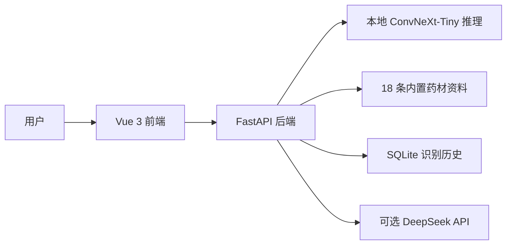
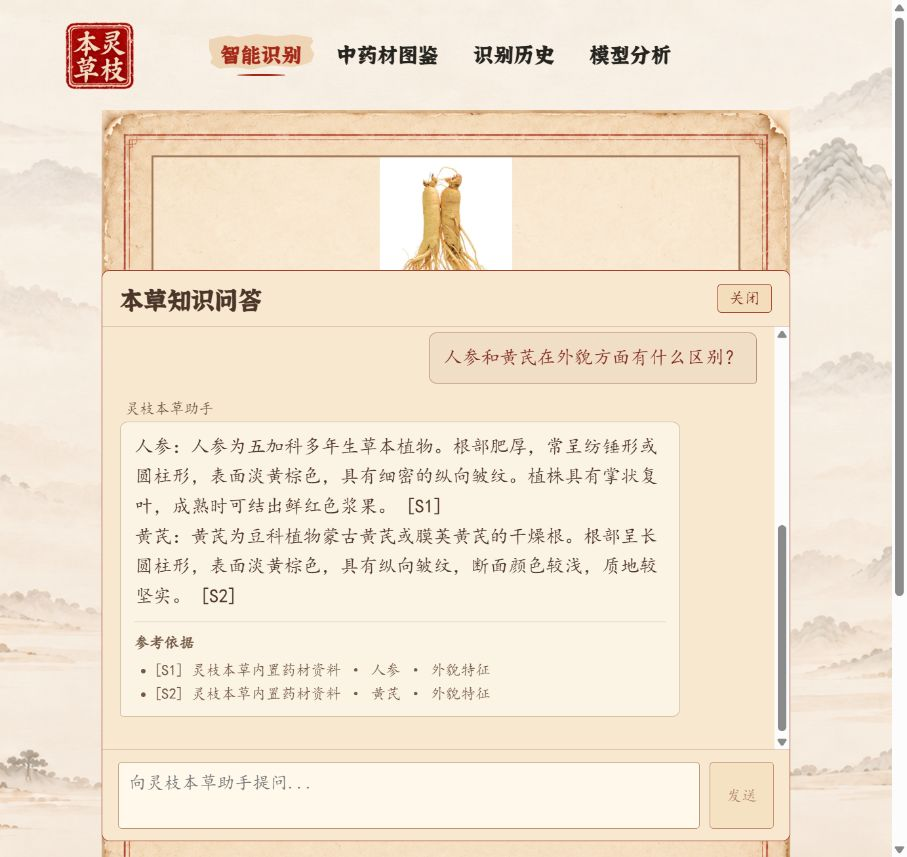
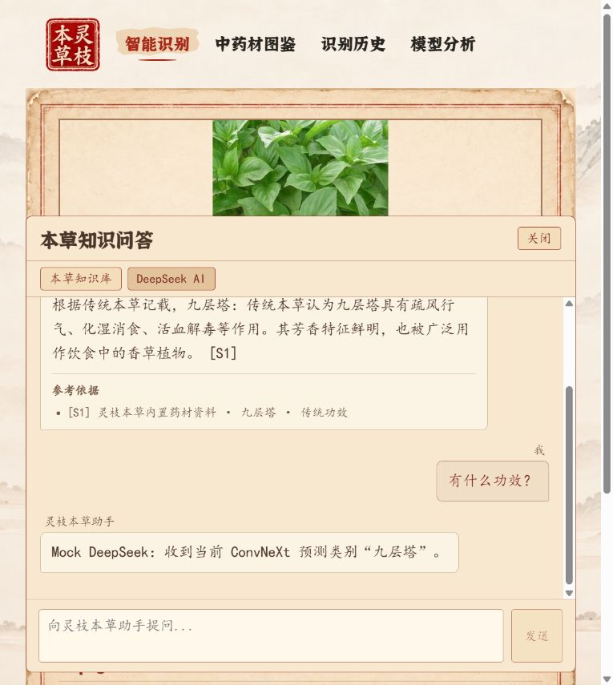

# 灵枝本草

**基于 ConvNeXt 与 DeepSeek 的中药材智能识别与本草文化学习系统**

第九届传智杯 AI 创新应用挑战赛（Vibe Coding）参赛作品。上传药材图片后，系统用本地 ConvNeXt-Tiny 预测类别，并在图鉴中展示相关资料；聊天区可手动选择本地“本草知识库”或“DeepSeek AI”。模型预测、内置资料和外部生成内容各有独立来源与适用范围。

## 核心功能

| 功能 | 当前实现 |
| --- | --- |
| 图像识别 | JPEG/PNG 上传，展示预测类别、置信度和 Top-3；前端在原始 Top-1 概率达到 0.60 时显示识别成功 |
| 本草图鉴 | 浏览 18 种药材的外貌、传统功效和典故等内置资料 |
| 识别历史 | SQLite 保存推理记录和上传图片，可浏览详情及删除记录 |
| 模型分析 | 展示 Run02 训练曲线、最终独立测试集指标和混淆矩阵 |
| 本草知识库 | 本地检索单药或双药资料，显示本次实际使用的来源，不调用 DeepSeek |
| DeepSeek AI | 普通问答、药材解释、比较、诗歌与故事等文本交流；模型回答不附加虚构的知识库来源 |
| 识别上下文 | 成功识别且映射到图鉴 ID 后，省略药名的问题可使用当前预测类别；低置信度和换图时清除旧上下文 |

## 技术栈与架构

- 后端：Python ≥3.10、PyTorch / Torchvision、ConvNeXt-Tiny、FastAPI 0.162.0、Uvicorn 0.54.0、httpx 0.28.1、Pillow、SQLite（标准库）。Python 深度学习依赖版本未完整锁定。
- 前端：Vue 3、Vue Router 4、Vite 7、Axios、markdown-it；具体安装版本见 `frontend/package-lock.json`。
- 外部生成服务：可选的 DeepSeek Chat Completions API；本地知识库及图像识别不依赖该 API。



架构和数据流见[系统架构](docs/architecture.md)，双模式行为见[AI 助手](docs/ai-assistant.md)。

## 模型与数据

数据治理后有 **5,275 张有效图片、18 类**，固定划分为训练 **3,692**、验证 **795**、独立测试 **788** 张。模型以 ImageNet 预训练 ConvNeXt-Tiny 迁移学习；Run02 第 8 轮由验证集 Macro-F1 选出，验证集 Accuracy **96.98%**、Macro-F1 **96.62%**。该权重在独立测试集上的 Accuracy **97.08%**、Macro-Precision **97.11%**、Macro-Recall **96.67%**、Macro-F1 **96.76%**，正确 **765/788** 张。来源见[数据划分报告](reports/data_split/split_report.md)、[实验日志](docs/experiment-log.md)及[最终测试归档](experiments/final_evaluation/evaluation_summary.md)。验证集与测试集指标分别统计。

**模型权重不在 Git 仓库中。** 从[模型 Release](https://github.com/zhizhezhang/hurb-classification/releases/tag/model-run02-epoch8-f1f2c67)下载 [convnext_tiny_best.pt](https://github.com/zhizhezhang/hurb-classification/releases/download/model-run02-epoch8-f1f2c67/convnext_tiny_best.pt)，保存为仓库根目录的 `models/convnext_tiny_best.pt`（111,392,415 字节）。SHA256：`202072243d01e7e47a4e008e0e6480d5446a2124f48f8512cca1ea3b379e814f`。也可用 `HERB_MODEL_PATH` 指向该权重。后端启动时会校验权重、类别映射和实验归档；仅克隆源码仍需另行下载权重才能启动识别。详见[模型文档](docs/model.md)。

## 快速开始

以下命令从**仓库根目录**开始。先准备 Python ≥3.10、Node.js/npm，以及与机器兼容的 PyTorch 和 Torchvision。Python 环境没有完整锁定；全新机器上的安装尚未端到端验证。可按以下命令克隆公开仓库：

```powershell
$repoUrl = 'https://github.com/zhizhezhang/hurb-classification.git'
git clone $repoUrl lingzhi-bencao
Set-Location .\lingzhi-bencao
```

```powershell
# 在已克隆的仓库根目录，使用选定的 Python 环境
python -m pip install -r .\convnext-herb-classifier\requirements.txt
python -m pip install -r .\backend\requirements.txt
python -m pip install -e .\convnext-herb-classifier --no-deps --no-build-isolation
Set-Location .\frontend
npm ci
Set-Location ..
```

可编辑安装需要 setuptools ≥61。下载并核验模型权重后，将其放到 `models/convnext_tiny_best.pt`，或在启动后端的终端设置 `HERB_MODEL_PATH`。具体下载与校验命令见[部署说明](docs/deployment.md)。**另开终端**，从仓库根目录启动：

```powershell
python -m uvicorn backend.main:app --host 127.0.0.1 --port 8000
```

再在前端目录启动开发服务：

```powershell
Set-Location .\frontend
npm run dev
```

打开 `http://127.0.0.1:5173/recognition`；后端健康检查为 `http://127.0.0.1:8000/api/health`，OpenAPI 文档为 `http://127.0.0.1:8000/docs`。Vite 默认将 `/api` 转发到 8000；更换后端端口时，先设置 `HERB_API_PROXY_TARGET`。详细变量、启动顺序与故障排查见[部署说明](docs/deployment.md)。

### DeepSeek 配置

“DeepSeek AI”模式调用外部 API，需要在**后端进程环境**中配置 `DEEPSEEK_API_KEY`，可能产生费用。不要将密钥写入源码、前端、已跟踪 `.env` 文件或终端日志。未配置时模型请求返回 HTTP 503；本草知识库、识别、图鉴、历史与模型分析仍可使用。`DEEPSEEK_MODEL` 默认是 `deepseek-flash`，实际可用模型取决于账号及服务配置。本仓库的自动化问答测试使用 Mock，不能当作真实付费接口质量验证。

## 目录

| 路径 | 用途 |
| --- | --- |
| `backend/` | API、模型加载、知识检索、DeepSeek 传输、SQLite 历史、测试 |
| `frontend/` | Vue 页面、聊天组件、测试与静态素材 |
| `convnext-herb-classifier/` | ConvNeXt 训练、预处理与评估代码 |
| `reports/data_*` | 数据审计、清洗、划分的真实报告 |
| `experiments/` | Run01、Run02、最终测试归档 |
| `docs/` | 当前技术文档、实验日志与历史设计记录 |
| `reports/competition/` | 参赛阶段联调报告和真实浏览器截图 |
| `models/` | 模型权重放置说明；权重文件不入库 |

原始图片数据、模型权重、训练运行目录、运行时数据库与上传图片不随 Git 分发。

## 界面截图

以下为参赛版浏览器实测截图，不是效果图：





更多页面和问题复现见[C4.1 联调报告](reports/competition/c4_1_integration_report.md)及[C4.6 上下文联调报告](reports/competition/c4_6_context_report.md)。截图反映拍摄时的状态，当前行为以源码和现行技术文档为准。

## 测试与范围

在已准备权重和测试所需原始图片的环境中，从仓库根目录运行：

```powershell
python -m unittest discover -s backend/tests -v
Set-Location .\frontend
node --test tests/*.test.js
npm run build
```

后端测试包含真实图片推理用例，依赖本地未入库数据集；前端测试与问答 Mock 不发送真实 DeepSeek 请求。最近一次参赛阶段记录为后端 **79/79**、前端 **23/23** 通过，详情见[联调报告](reports/competition/c4_6_context_report.md)；本次文档整理后的结果以交付报告为准。

模型只覆盖 18 类，低置信度时不把 Top-1 作为已确认上下文；知识库只回答已收录且有对应字段的内容。DeepSeek 文本不经过本地图鉴事实校验。模型识别和传统功效资料用于学习，不构成实物鉴定或个体化用药建议。历史 [C1 架构设计](docs/competition/knowledge-enhanced-ai-design.md) 和 [环境核验记录](docs/environment-verified.md)保留开发阶段事实，其中旧方案及旧端口不代表当前双模式行为。

本仓库以独立发布快照建立新 Git 历史。导出和路径脱敏范围见[公开版本说明](PUBLICATION_NOTES.md)，真实需求修正与测试证据见[AI 协作迭代索引](docs/competition/ai-development-record.md)。完整原始对话及旧开发提交仍留在开发工作区，未伪装成公开仓库历史。

## 许可证

本项目原创源码采用 [MIT License](LICENSE)。ConvNeXt 模型权重单独发布，其使用条件以对应模型发布说明为准；第三方预训练资源、字体、图片素材、训练数据及其他第三方资源遵循各自适用的授权条件。素材来源说明见[素材清单](docs/asset-manifest.md)与[公开版本说明](PUBLICATION_NOTES.md)。
