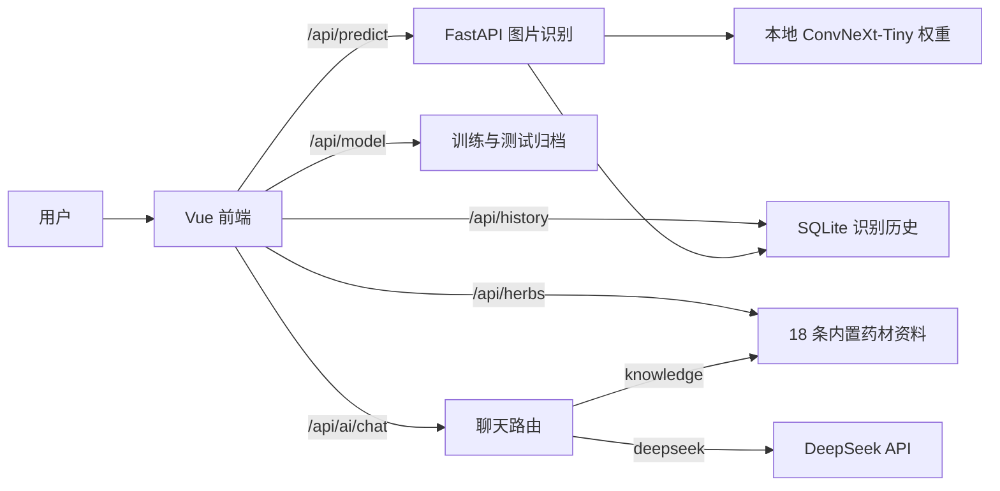

# 系统架构

灵枝本草由 Vue 3 前端、FastAPI 后端、本地 ConvNeXt-Tiny 分类模型、18 条内置药材资料和可选的 DeepSeek API 组成。系统提供识别、图鉴、历史、模型分析和双模式问答。

## 图像识别

`frontend/src/views/RecognitionView.vue` 上传 JPEG/PNG，调用 `POST /api/predict`。`backend/services/model_loader.py` 在应用启动时加载本地权重，校验类别映射、预处理配置及实验归档。推理返回 Top-3、置信度与记录 ID；成功推理的图片和结果写入 `backend/runtime/` 的 SQLite 历史。前端用原始 Top-1 概率与 0.60 阈值决定显示识别成功或低置信度状态；低置信度结果不作为聊天上下文。

成功识别后，前端从图鉴按预测中文类别查找 ID。只有有效映射和成功状态才把 `herb_id` 传给聊天组件。切换图片时立即清除旧上下文，异步请求用版本号防止过期结果覆盖当前图片。聊天接口只接收问题和可选 ID，不接收原始图片。

## 问答与数据

`POST /api/ai/chat` 使用可选 `mode`。`knowledge` 只从启动时加载的 `backend/data/herbs.json` 中检索并组织回答，返回实际使用的来源，不调用外部模型。`deepseek` 通过 `backend/services/ai_service.py` 向 DeepSeek 发送一次普通文本请求；若有有效 `herb_id`，仅把对应预测药材名称作为文字上下文，不发送图片，也不把模型输出包装为知识库证据。旧客户端不传 `mode` 时保留原兼容路径，详见 [AI 助手文档](ai-assistant.md)。

历史采用 SQLite，保存识别记录与上传文件名；图鉴来自 JSON，模型分析读取 `experiments/run02/` 与 `experiments/final_evaluation/` 的归档。开发环境中 Vite 将 `/api` 代理到 FastAPI，生产构建仅生成静态资源，仓库未提供经验证的一键生产部署方案。

## 模块入口

| 路径 | 职责 |
| --- | --- |
| `backend/main.py`、`backend/api/` | 应用生命周期与 HTTP 路由 |
| `backend/services/` | 推理、图鉴、知识检索、DeepSeek、历史、模型分析 |
| `backend/schemas/` | 请求与响应格式 |
| `convnext-herb-classifier/herb_classifier/` | 模型结构、预处理、训练与评估实现 |
| `frontend/src/views/`、`frontend/src/components/` | 页面与聊天组件 |
| `reports/data_split/`、`experiments/` | 固定划分与真实实验归档 |

权重、原始数据集、运行时数据库和密钥不在 Git 中。模型细节见 [模型文档](model.md)，运行步骤见 [部署文档](deployment.md)。
