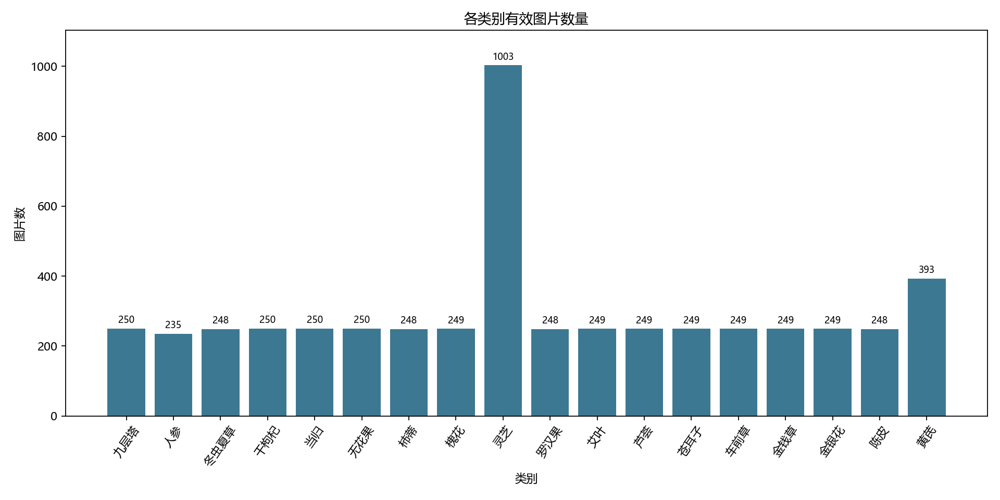
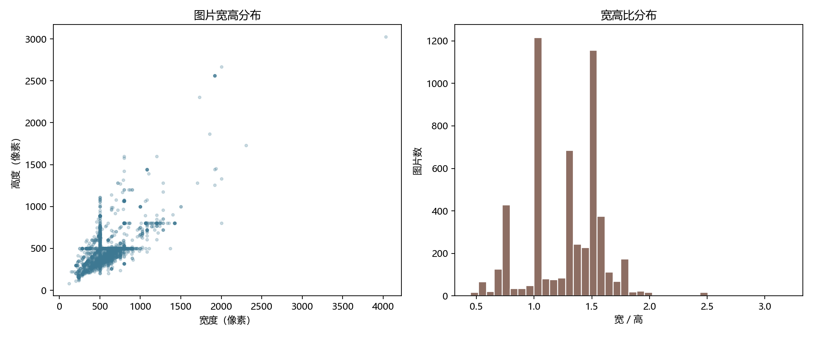

# 中药材图像数据集分析报告

- 数据集路径：`Chinese Medicine datasets`
- 类别数：**18**
- 文件总数：**5366**；有效图片：**5366**；无效/未解码文件：**0**
- 随机抽样种子：`20261027`；每类最多 `12` 张

## 类别分布

| 类别 | 文件数 | 有效图片 |
|---|---:|---:|
| 九层塔 | 250 | 250 |
| 人参 | 235 | 235 |
| 冬虫夏草 | 248 | 248 |
| 干枸杞 | 250 | 250 |
| 当归 | 250 | 250 |
| 无花果 | 250 | 250 |
| 柿蒂 | 248 | 248 |
| 槐花 | 249 | 249 |
| 灵芝 | 1003 | 1003 |
| 罗汉果 | 248 | 248 |
| 艾叶 | 249 | 249 |
| 芦荟 | 249 | 249 |
| 苍耳子 | 249 | 249 |
| 车前草 | 249 | 249 |
| 金钱草 | 249 | 249 |
| 金银花 | 249 | 249 |
| 陈皮 | 248 | 248 |
| 黄芪 | 393 | 393 |

有效图片最多/最少类别数量比：**4.27**；变异系数：**0.584**。

## 图像属性

- 文件扩展名：`{'.jpg': 1631, '.png': 3735}`
- Pillow 实际格式：`{'BMP': 3, 'JPEG': 5272, 'PNG': 91}`
- 颜色模式：`{'RGB': 5279, 'RGBA': 87}`
- 扩展名/实际格式组合：`{'.jpg → JPEG': 1629, '.jpg → PNG': 2, '.png → BMP': 3, '.png → JPEG': 3643, '.png → PNG': 89}`
- 宽度（像素）统计：`{'min': 120.0, 'median': 500.0, 'p95': 841.5, 'max': 4032.0}`
- 高度（像素）统计：`{'min': 80.0, 'median': 500.0, 'p95': 764.75, 'max': 3024.0}`
- 宽高比统计：`{'min': 0.45, 'median': 1.334, 'p95': 1.7512, 'max': 3.1915}`
- 文件大小（字节）统计：`{'min': 4357.0, 'median': 46657.0, 'p95': 127110.0, 'max': 1825466.0}`

## 异常与重复候选

- 异常记录 **3653** 条（同一文件可有多条）：`{'extension_format_mismatch': 3648, 'extreme_aspect_ratio': 1, 'small_dimension': 4}`。
- SHA-256 完全重复组 **53** 组，涉及 **106** 个文件；其中跨类别 **0** 组。
- pHash 阈值：汉明距离 ≤ **6**；独立哈希值 **5091** 个；候选哈希比较 **222267** 次。
- 不同 SHA-256 的 pHash 相似图片对 **366** 对，其中跨类别 **0** 对。
- 候选筛选完成：**True**；pHash 相似对导出完整：**True**；跨类别完全重复对导出完整：**True**。

pHash 仅提示视觉相似，不能单独证明重复或标签错误；图像网格与跨类别候选需要人工核对。
训练、验证和测试集划分前，应先处理已核实的重复组，避免相同或近似图片分布到不同子集造成数据泄漏。

## 数据质量风险及人工审核

固定种子抽样网格中，九层塔可见带文字/水印的图片及鲜株、叶片、菜品等不同呈现方式；灵芝可见野生、干品和盆景等差异。
这些观察仅来自抽样，应人工核对标签定义与目标应用场景，并留意模型利用背景或文字而非药材外观进行分类的风险。
| 类别 | 文件 | 问题 | 说明 |
|---|---|---|---|
| 九层塔 | `九层塔/九层塔 (1).png` | extension_format_mismatch | extension=PNG; content=JPEG |
| 九层塔 | `九层塔/九层塔 (100).png` | extension_format_mismatch | extension=PNG; content=JPEG |
| 九层塔 | `九层塔/九层塔 (101).png` | extension_format_mismatch | extension=PNG; content=JPEG |
| 灵芝 | `灵芝/03 (974).jpg` | extreme_aspect_ratio | 3.1915 |
| 灵芝 | `灵芝/03 (121).jpg` | small_dimension | 236x126 |
| 灵芝 | `灵芝/03 (163).jpg` | small_dimension | 236x118 |
| 苍耳子 | `苍耳子/苍耳子 (107).png` | small_dimension | 200x112 |
| 金银花 | `金银花/金银花 (198).png` | small_dimension | 120x80 |

记录超过 10 条的问题仅展示前 3 条；完整记录见 异常清单 (`anomalies.csv`; 原始附件未随公开源码提供)。

## 下一阶段清洗建议

1. 当前跨类别候选为空；仍需抽检标签，新增数据后重新检查跨类别重复。
2. 复核低分辨率和极端宽高比文件；对大量扩展名与编码不符的图片，在派生数据目录中统一编码和文件名，不改动原件。
3. 人工核对同类 SHA-256 重复组及 pHash 候选，为确认的重复/近重复样本建立分组；后续按组划分数据集，防止泄漏。
4. 结合类别数量和抽样网格核对标签定义、拍摄背景、文字水印与类别偏差，再决定训练阶段的平衡策略。

## 产物索引

- 逐文件清单 (`images.csv`; 原始附件未随公开源码提供) · [类别统计](class_summary.csv) · 异常清单 (`anomalies.csv`; 原始附件未随公开源码提供) · 完全重复组 (`exact_duplicate_groups.csv`; 原始附件未随公开源码提供)
- pHash 相似对 (`phash_similar_pairs.csv`; 原始附件未随公开源码提供) · 跨类别候选 (`cross_class_candidates.csv`; 原始附件未随公开源码提供) · [机器可读摘要](summary.json)
- 每类抽样网格 (`sample_grids/`; 原始附件未随公开源码提供) · [类别数量图](class_counts.png) · [图片尺寸图](image_dimensions.png)
