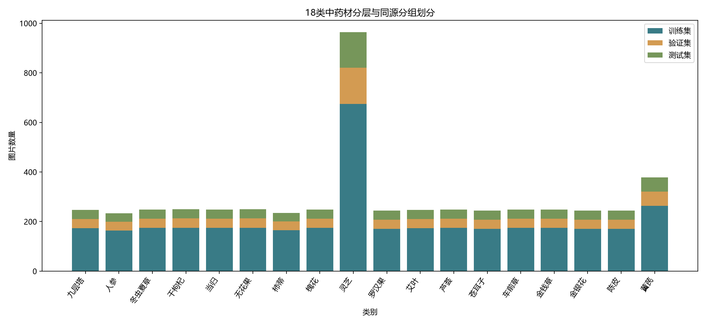

# 数据集划分与验证报告

- 输入：复核后有效样本 **5275** 张，18 类；随机种子 **42**。
- 方法：先将人工确认同源的有效图片组成不可拆分单元，其余图片各成独立单元；再逐类别按 70/15/15 目标分配完整单元。
- 预处理：ConvNeXt-Tiny ImageNet-1K V1 权重对应的 RGB、224×224 和 ImageNet 均值/标准差；具体参数见 [预处理配置](preprocess_config.json)。

## 实际划分

| 子集 | 数量 | 实际比例 | 目标比例 |
|---|---:|---:|---:|
| train | 3692 | 69.99% | 70% |
| val | 795 | 15.07% | 15% |
| test | 788 | 14.94% | 15% |

| 类别 | 总数 | 训练 | 验证 | 测试 |
|---|---:|---:|---:|---:|
| 九层塔 | 247 | 173 | 37 | 37 |
| 人参 | 234 | 164 | 35 | 35 |
| 冬虫夏草 | 248 | 174 | 37 | 37 |
| 干枸杞 | 250 | 175 | 38 | 37 |
| 当归 | 249 | 174 | 38 | 37 |
| 无花果 | 250 | 175 | 38 | 37 |
| 柿蒂 | 235 | 165 | 35 | 35 |
| 槐花 | 248 | 174 | 37 | 37 |
| 灵芝 | 964 | 675 | 145 | 144 |
| 罗汉果 | 245 | 171 | 37 | 37 |
| 艾叶 | 247 | 173 | 37 | 37 |
| 芦荟 | 249 | 174 | 38 | 37 |
| 苍耳子 | 244 | 171 | 37 | 36 |
| 车前草 | 249 | 174 | 38 | 37 |
| 金钱草 | 248 | 174 | 37 | 37 |
| 金银花 | 245 | 171 | 37 | 37 |
| 陈皮 | 245 | 171 | 37 | 37 |
| 黄芪 | 378 | 264 | 57 | 57 |

## 同源组与验证

- 确认同源组：**295** 组；有效图片最大组：**6** 张；独立分组：**4687** 个。
- 确认同源组保留后大小分布（含 0 张组）：`{0: 7, 1: 11, 2: 260, 3: 13, 4: 3, 6: 1}`。
- 所有划分单元大小分布：`{1: 4698, 2: 260, 3: 13, 4: 3, 6: 1}`。
- 异常大关系组：**0** 组（阈值为 max(10, 该类别样本数的 5%)）。
- 验证通过：路径互斥、完整覆盖、每个子集均含 18 类、确认同源组不跨子集、排除图片未进入、SHA-256 唯一、源图片路径存在。
- 若未来数据出现无法精确满足目标比例的大组，脚本会保留组完整并记录实际比例，不拆分同源组。

## 产物

- [训练集](train.csv) · [验证集](val.csv) · [测试集](test.csv) · [类别映射](class_to_idx.json)
- [划分配置](split_config.json) · [独立验证结果](validation_results.json) · [统计图](class_split_counts.png)
