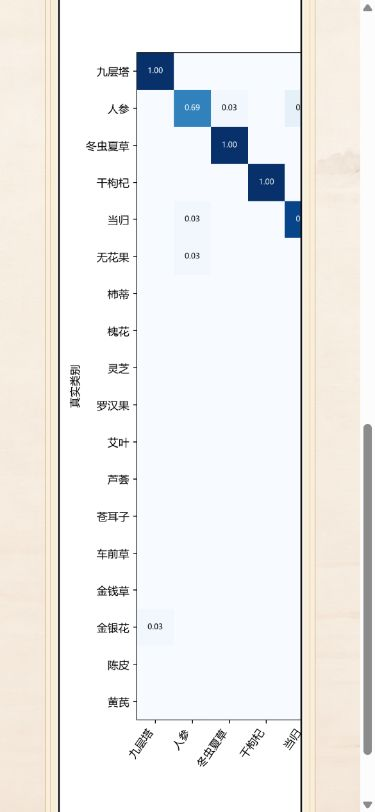
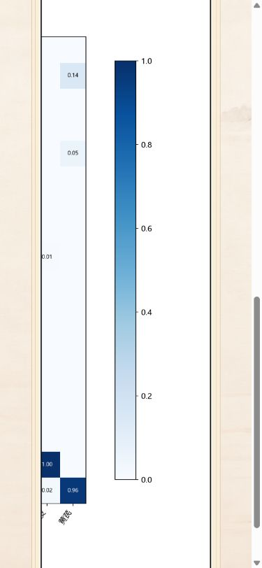

# 06.6 全系统集成测试报告

测试日期：2026-10-30（Asia/Shanghai）
测试范围：现有功能验证与问题排查；未修改业务代码、模型、实验归档或真实历史数据。

> 本文第 1–10 节保留首轮测试时的结果与结论；06.6.1 修复和定向复测见第 11 节，后者是当前状态。

## 1. 基线与环境

| 检查项 | 状态 | 实测结果 |
|---|---|---|
| Git 基线 | PASS | `main`；HEAD `82e7a38 fix: polish recognition confidence handling and AI chat experience`；此前提交为 `0f9bc9f`、`055324c`。测试前只有 `.tmp-atlas-qa-0631/`、`frontend/public/assets/ai_reference_diagram/`、`output/` 三个既有未跟踪目录。 |
| Python / 依赖 | PASS | Conda `herb-classifier`，Python 3.11.18；torch 2.13.0+cu126、torchvision 0.28.0+cu126、FastAPI 0.162.0、Pillow 12.3.0、httpx 0.28.1 可导入。 |
| 设备与模型 | PASS | RTX 4060 Laptop GPU，CUDA 可用；权重 `models/convnext_tiny_best.pt` 存在；`GET /api/health` 返回 `model_loaded=true`、18 类、`device=cuda:0`。测试未训练或改写权重。 |
| 后端 / 前端 / 代理 | PASS | 现有 8001 后端和 5173 Vite 前端可用；5173 `/api/health` 正确代理到后端。8000 端口已有监听但 HTTP 超时，测试未终止该进程。隔离验证另用 8002 后端、5175 前端；模拟问答/预测用 8003、5176；临时服务已停止。 |
| 数据保护 | PASS | 上传、预测、删除只在临时独立 SQLite 与上传目录执行；测试后删除了**本次创建**的临时目录。真实历史接口只做 GET，测试时返回 22 条；未删除或修改真实记录。DeepSeek 仅用本地模拟响应。 |

## 2. 自动化与工程检查

| 项目 | 状态 | 结果 |
|---|---|---|
| 指定 pytest 命令 | BLOCKED | `python -m pytest backend/tests -q` 退出 1：Conda 环境未安装 `pytest`（`No module named pytest`）。项目测试配置未声明 pytest；本轮未更改环境依赖。 |
| 后端现有测试替代执行 | PASS | `python -m unittest discover -s backend/tests -v`：56 个测试，通过 56、失败 0、跳过 0。覆盖模型启动/异常、JPG/PNG 真实推理、上传校验、Top-3、历史 CRUD 与图片、药材查询、Run02 指标/原始图表、AI 上游模拟及超时、原始概率持久化。仅有 Starlette 弃用警告。 |
| 前端现有测试 | PASS | `node --test --test-isolation=none tests/*.test.js`：13 个测试，通过 13、失败 0、跳过 0。覆盖原始概率 60% 边界、旧历史记录、农历/时辰、4/5/6 条窗口逻辑、Markdown 与 XSS。关闭 Node 子进程隔离是当前沙箱内避免 `spawn EPERM` 所需的执行参数，未改测试代码。 |
| 前端构建 | PASS | `frontend` 执行 `npm run build`：Vite 7.3.7，129 个模块，构建成功。 |
| Git 补丁校验 | PASS | 报告完成后执行 `git diff --check` 与 `git diff --cached --check`；结果见最终 Git 状态。 |

自动化合计：**69 通过，0 失败，0 跳过**；指定 pytest 入口另记为 **BLOCKED**，不计入通过数。

## 3. 智能识别

| 检查项 | 状态 | 实测结果 |
|---|---|---|
| JPG、PNG 自动识别 | PASS | 浏览器分别上传真实数据集 JPG/PNG 到隔离后端，自动返回“人参 99.89%”和“九层塔 99.97%”；名称、插画、简介、Top-3 均显示。后端测试还对照离线预测文件核验类别与原始置信度。 |
| 新图片清理旧结果 | PASS | 选择 PNG 后，页面先仅显示“正在识别…”，先前人参结果消失；完成后显示九层塔结果。 |
| 快速连续上传 | PASS | 本地模拟第一请求延迟 2 秒、第二请求先完成；页面最终及旧请求返回后均保持第二张图片的九层塔结果和简介。 |
| Top-3 排序与映射 | PASS | 真实推理测试验证三项概率降序、首项类别与 Top-1 一致；浏览器成功态显示对应插画与简介。 |
| 60% 原始概率边界 | PASS | 单元测试验证 0.1403、0.5999 失败，0.6000、0.6001 成功；浏览器模拟另验证上述四值和 0.9987。低值保留上传预览，不显示预测名称、药材插画、简介或 Top-3；高值正常显示。0.59999 也按原始概率失败。 |
| 非图片、空/损坏、超 10 MiB、超像素限制 | PASS | 后端隔离测试验证拒绝和无历史脏写入；前端浏览器未逐项打开文件选择器，前端提示文案仅按现有代码检查，**不将其算作浏览器 PASS**。 |

## 4. 识别历史

| 检查项 | 状态 | 实测结果 |
|---|---|---|
| 自动保存、时间降序、原始预测 | PASS | 隔离环境两次浏览器预测产生两条记录，最新 PNG 在前；API 保存的 `confidence`、`top3`、模型版本与预测响应一致。后端测试验证分页、排序和图片原字节。 |
| 4/5/6 条卷轴窗口 | PASS | 隔离环境 4 条无箭头；5 条可由首 4 条移到后 4 条；6 条两次前进使平移量从 0 到 -236.863px、-473.726px，始终最多 4 条可见，CSS 过渡时长 0.6 秒。窄屏 390px 实测显示 2 条卷轴且无横向溢出。 |
| 农历、时辰、公历提示 | PASS | 单元测试覆盖春节、闰月、日期与时辰边界；浏览器点击时间显示 `2026-10-30 22:32`，与记录 UTC 时间换算一致。鼠标 **Hover** 触发方式本轮未单独执行。 |
| 高、低置信度详情 | PASS | 既有真实低置信度记录只读打开后显示“识别失败”、提示和原图（480px 自然宽度），无药材插画/简介/Top-3；返回后打开高置信度记录，显示冬虫夏草、99.87% Top-1、简介、插画和原图。列表与详情的进入/退出均可操作，背景模糊可见。 |
| 删除仅影响目标 | PASS | **仅隔离 API** 删除 ID 2：删除响应 `deleted=true`，总数 2→1，ID 1 保留，ID 2 原图返回 404；后端自动测试亦覆盖删除一致性。 |
| 浏览器删除确认及列表即时更新 | BLOCKED | 自动化点击“删除记录”后，测试浏览器未暴露可接受的 `window.confirm` 对话框，页面仍停在详情。没有继续尝试可能误操作真实数据的路径。该项不能视作产品缺陷；需人工在隔离环境复核页面按钮。 |
| Hover Tooltip 与动画流畅度主观感受 | NOT RUN | 已验证点击时间提示、CSS 平移/过渡和进入/返回可操作；未用真实鼠标 Hover 或帧率采样验证动画流畅度。 |

## 5. 中药材图鉴

| 检查项 | 状态 | 实测结果 |
|---|---|---|
| 18 种药材与图片 | PASS | `/api/herbs` 返回 18 条；浏览器图鉴 DOM 中 18 幅药材图像全部 `complete` 且 `naturalWidth>0`，后端测试核对模型类别和插画路径。 |
| 轮播、详情、返回 | PASS | 浏览器从人参轮播至干枸杞，进入详情后名称与插画相符；`appearance`、`traditional_effects`、`allusion` 三段均在 DOM 中完整显示；390px 页面可纵向滚动，返回后仍为干枸杞。 |
| 快速进入/返回与全量列表重复请求 | NOT RUN | 普通流程已验证；浏览器性能请求计数接口在当前自动化沙箱中不可用，未据源码推断通过。 |
| 槐花素材来源 | NOT RUN | `docs/asset-manifest.md` 记录 `herb_huaihua.png` 原始素材名含“洋槐花枝”，且曾确认映射为槐花；`backend/data/herbs.json` 同时提示槐与洋槐并非同一植物来源。是否符合最终本草资料要求需人工核实原图来源，本轮未替换素材或改数据。 |

## 6. 模型分析

| 检查项 | 状态 | 实测结果 |
|---|---|---|
| 模型概览 | PASS | 真实 `/api/model/info` 返回 `convnext_tiny`、18 类、27,833,970 参数、224 输入；浏览器显示 ConvNeXt-Tiny、18类、27.83M、224 × 224。 |
| 最终测试集四指标 | PASS | 真实 `/api/model/metrics` 的 `final_test`：Accuracy 0.970812182741117、Macro-Precision 0.971100385285737、Macro-Recall 0.966691048818242、Macro-F1 0.967599982887828；浏览器分别显示 97.08%、97.11%、96.67%、96.76%。`weighted_f1=0.96986232671688`，页面未误用它；后端测试核验 Run02 归档/检查点来源及不混入 Run01。 |
| 原始图表 | PASS | `/api/model/charts/accuracy_curve` 与 `/api/model/charts/confusion_matrix_normalized` 均 200 `image/png`；分别 43,881 / 143,908 字节。浏览器图像自然尺寸 1120×640 / 2040×1870，显示宽高比与原图一致，无裁切或加载错误；后端测试核对原始 PNG 字节。 |
| 390px 混淆矩阵可读性 | FAIL | 18 类、2040px 宽原图在窄屏仅渲染为约 252px 宽；类别标签、格内数值需要放大才能辨认。图像完整、无横向溢出，但“清晰可读”未达到。详见缺陷 D-02。 |

## 7. DeepSeek 本地模拟

| 检查项 | 状态 | 实测结果 |
|---|---|---|
| 对话位置与布局 | PASS | 1440×900 下弹层约 700×600px，底部上弹、高度约视口 2/3；用户消息在右、助手消息在左，顺序正确。 |
| Markdown 与安全 | PASS | 模拟回复的 `**粗体**` 成为 `<strong>`，段落/换行/列表显示；原始 `<script>` 仅作为转义文本，无脚本节点；前端单测同时覆盖危险链接与图片标签过滤。 |
| 长回复、滚动、会话保留 | PASS | 约 200 次重复长文本使滚动区可滚动，新消息后 `scrollTop` 到达底部；关闭再打开保留原两条消息。 |
| 网络错误 | PASS | 第二次模拟请求返回 503，页面显示“问答服务暂不可用，请稍后重试。”，既有会话保留。后端自动测试覆盖上游状态、超时和网络异常。 |
| 弹层内输入框文案 | FAIL | 实际 `textarea` 占位文字和无障碍名称为“输入本草问题…”；验收表要求“向灵枝本草助手提问...”。底部固定入口有“向 灵枝本草助手 提问…”，但不能代替输入框文案。详见缺陷 D-01。 |
| 真实 DeepSeek 付费接口 | NOT RUN | 按要求没有发送真实上游请求；不得据模拟测试宣称真实密钥/额度/线上稳定性通过。 |

## 8. 异常场景与浏览器回归

| 检查项 | 状态 | 实测结果 |
|---|---|---|
| 模型加载失败 | PASS | 隔离单测验证缺失、损坏、状态字典不完整、类别不符的检查点会显式阻止启动；没有改动真实权重。 |
| 不存在的药材、历史、图表 | PASS | 真实只读请求对不存在 ID/图表返回 404；单测覆盖历史图片缺失及图片路径安全。 |
| 请求超时、网络异常 | PASS | AI 上游使用 MockTransport 的后端测试覆盖超时/网络错误；浏览器 503 模拟提示正常。 |
| 前端后端断连 | NOT RUN | 未主动断开现有 8001 服务；未对四页逐一模拟断连。 |
| 四页直接访问与刷新 | PASS | `/recognition`、`/atlas`、`/history`、`/analysis` 在浏览器均能直达并刷新，主内容出现；控制台未见 error 级日志。 |
| 五档视口 | PASS | 四页 × 1920×1080、1440×900、1366×768、1024×768、390×844，共 20 个组合；`documentElement.scrollWidth <= innerWidth`，导航 `aria-current=page` 均正确，Logo 加载且字体族为楷体配置。 |
| PNG 与图表清晰度 | FAIL | 浏览器未发现破图；桌面图表比例正常。但 390px 混淆矩阵可读性失败，见 D-02。 |

## 9. 缺陷与处理建议

| 编号 / 严重度 | 复现、实际与预期 | 可能位置与建议 |
|---|---|---|
| D-01 / 低 | 打开智能识别页底部问答弹层，查看输入框：实际占位符“输入本草问题…”；本轮验收表要求“向灵枝本草助手提问...”。 | `frontend/src/components/recognition/DeepSeekChat.vue` 的 `textarea` 文案。建议在用户确认后统一占位符和无障碍名称；本轮未改代码。 |
| D-02 / 中 | 390×844 打开模型分析并滚动至混淆矩阵：18类矩阵完整但渲染宽约 252px，原始细小标签和数值无法直接清晰辨认；预期清晰可读且不裁切。 | `frontend/src/views/AnalysisView.vue`、`frontend/src/styles/analysis.css` 的窄屏图表容器。建议在用户批准后评估可放大查看原始图或其他不裁切的窄屏呈现方式；不得改真实 PNG、类别顺序或数值。 |

槐花/洋槐素材来源是**待核实风险**，证据不足以断言为本轮新增缺陷。pytest 缺失和浏览器确认框自动化限制属于**测试环境缺口**，不归类为产品失败。

## 10. 结论与遗留工作

- **建议：暂不宣布 06.6 最终验收通过。** 自动化 69/69 通过、20/20 基础响应式组合通过，核心推理/历史/图鉴/Run02 指标/模拟 AI 能工作；但 D-01 文案和 D-02 窄屏矩阵可读性未满足本轮检查表。是否接受这两项偏差由用户决定。
- **待执行：** 指定 pytest 入口（需环境具备 pytest）、隔离环境中的浏览器删除确认、真实 Hover Tooltip 与动画帧表现、图鉴快速进入/返回及全量列表请求次数、四页后端断连、真实 DeepSeek 请求（需要另行明确授权）、槐花素材来源人工核实。
- **数据安全：** 所有临时模拟服务、隔离数据库和测试上传目录已停止/删除；既有未跟踪目录未清理；未创建 Git 提交。

## 11. 06.6.1 修复与定向复测（2026-10-30）

本节只更新 D-01、D-02 的当前状态，并记录新增的实际测试。上文的首轮 FAIL/BLOCKED/NOT RUN 是历史记录，不代表本节复测结果。未调用真实 DeepSeek，也未修改真实历史、模型、实验归档和 PNG。

### 11.1 已修复问题

| 问题 | 根本原因、修改与当前状态 |
|---|---|
| D-01 输入框文案 | **已修复，PASS。** `DeepSeekChat.vue` 的 `textarea` 仍沿用“输入本草问题…”占位符；只将 `placeholder` 改为准确的“向灵枝本草助手提问...”。没有改弹层尺寸、消息样式、无障碍名称、Markdown 或请求逻辑。浏览器弹层中直接读取到新占位符；本地模拟 POST 后用户/助手消息顺序正常，粗体为 `<strong>`、列表两项、原始 `**` 不暴露。 |
| D-02 390px 矩阵可读性 | **已修复，PASS，待用户视觉验收。** 原图使用 `width:100%` 随窄屏面板从 2040px 自然宽缩到 252px。现仅为矩阵增加可聚焦的局部横向滚动容器，`max-width:800px` 时图片显示为 960×880，保持 2040×1870 原始比例；容器可视宽 252px、内容宽 960px，键盘横滚从 `scrollLeft=0` 到最大值 708，右侧刻度和色条可见。`documentElement.scrollWidth=375 <= 390`。1366px 时两图仍为 452×258 / 452×414，1920px 时仍为 661×378 / 661×606，与首轮一致。图片 URL 仍为 `/api/model/charts/confusion_matrix_normalized`，未改 Run02 PNG 或接口。 |

390×844 实际浏览器截图（同一页面横滚左端与右端）：

### 11.2 定向验证

| 检查项 | 状态 | 实测证据 |
|---|---|---|
| AI 输入、发送、Markdown | PASS | 本地模拟接口返回段落、换行、`**粗体**` 和列表；页面显示用户消息在右、助手在左，发送成功，粗体/列表正确。输入占位符精确匹配 `向灵枝本草助手提问...`。未发起真实 DeepSeek 请求。 |
| 矩阵 18 类横向阅读与原图 | PASS | 390px 截图和滚动位置 0→708 显示左端类别、右端末尾类别/色条；自然尺寸 2040×1870，显示尺寸 960×880，无拉伸。训练曲线仍为原接口图。 |
| 页面整体横向溢出 | PASS | 390px 模型分析页 `scrollWidth=375`；识别/图鉴/历史各为 390；其余三页在 1366px、1920px 也均未超出视口。 |
| 桌面布局保持 | PASS | 1366px、1920px 两图实测尺寸与首轮基线相同；模型概览/性能的原有布局未修改。 |
| 其他三页回归 | PASS | 识别、图鉴、历史在 390、1366、1920px 共 9 个组合可加载，导航选中正确，未见破图或横向溢出。 |
| 前端现有测试与构建 | PASS | `node --test --test-isolation=none tests/*.test.js`：13/13；`npm run build`：Vite 7.3.7，129 模块，构建成功。未重复执行后端完整 56 项 unittest；隔离后端参与下述补测。 |
| Git 差异检查 | PASS | 第 11 节写完后执行 `git diff --check`、`git diff --cached --check`；结果见本节末尾 Git 状态。 |

### 11.3 首轮遗留项补测

| 检查项 | 状态 | 实测证据 |
|---|---|---|
| 历史删除确认 | PASS | 独立 SQLite/上传目录中先生成低置信度记录 ID 1；浏览器打开详情，点“删除记录”，捕获并接受 `window.confirm`；列表随后显示“暂无识别记录”，隔离 API 总数 0，原图接口 404。真实历史未写入/删除。 |
| 历史卷轴快速切换 | PASS | 隔离库创建 6 条后在 1440px 连续两次前进、两次后退；轨道从 0 移到 `-541.247px` 再回 0，均维持 4 条可见、过渡设置为 0.6s、无错误提示。未做帧率采样，因此**动画主观流畅度仍 NOT RUN**。 |
| 图鉴快速进入/返回 | PASS | 隔离后端上快速打开人参、立即返回、再次打开；中途无错误，返回仍选中人参，重进详情为人参且三段资料齐全。后端访问日志中全量 `/api/herbs` 仅 1 次、单项 `/api/herbs/renshen` 2 次，无重复加载全量列表。 |
| 图鉴/历史/模型分析后端断连 | PASS | 独立 Vite 实例代理至未监听的 127.0.0.1:8999；三个页面分别显示“药材图鉴暂时无法加载”“识别历史暂时无法加载”、概览/指标/两图的独立失败提示，页面未崩溃；未关闭现有 8001 服务。 |
| 智能识别后端断连提示 | FAIL | 同一断连代理下上传有效临时 PNG，页面稳定且保留预览，但显示“识别失败，请重新选择图片。”；实际故障是后端不可连接。见下方 D-03，不在本次授权的两项修复范围内。 |
| 农历日期 **Hover** Tooltip | NOT RUN | 浏览器自动化能点击时间并显示对应公历，但本轮没有纯悬停输入动作；不能把点击结果当作 Hover 通过。 |
| 真实 DeepSeek 付费 API | NOT RUN | 本轮只使用本地模拟回复，不调用付费上游。 |

### 11.4 新发现问题与剩余风险

| 编号 / 严重度 | 复现、实际与预期 | 建议 |
|---|---|---|
| D-03 / 中 | 用代理到未监听后端端口的 Vite 访问智能识别，上传合法 PNG：网络/代理故障被显示为“识别失败，请重新选择图片。”；预期明确提示服务或网络不可用，避免误导用户反复换图。 | 当前 `RecognitionView.vue` 的请求错误分支在代理返回 HTTP 500 时进入通用“识别失败”提示。需另行批准后定向修复及测试；本次未越界修改。 |

剩余：Hover Tooltip 的纯悬停验证、卷轴动画帧率/主观流畅度、真实 DeepSeek、槐花与洋槐素材来源核实、指定 pytest 入口（环境仍缺 pytest）。D-01/D-02 已按要求修复并完成自动浏览器复测；定向复测结束时仍待用户实际浏览器确认，且 D-03 需要后续决定。测试阶段未创建提交，未处理既有未跟踪目录。

定向复测结束时的 Git 状态（归档提交前）：`main`，HEAD 为 `82e7a38`；工作区仅有本次三个前端文件的未暂存修改、本报告与两张报告截图为新未跟踪文件，另有原本存在的 `.tmp-atlas-qa-0631/`、`frontend/public/assets/ai_reference_diagram/`、`output/`；暂存区为空。`git diff --check` 与 `git diff --cached --check` 均通过。
